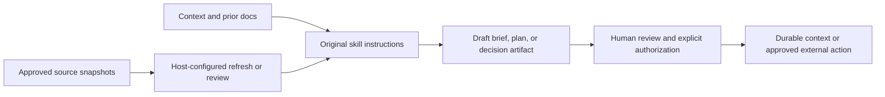

# Company OS

I kept rebuilding the same context whenever I asked an agent to help with product work. Company OS puts that context, the workflow instructions and the output in files I can read and reuse.

This is the workspace I use for planning, status reviews, research, roadmaps and writing. You bring the agent host and your own company information. There isn't a separate app, background agent or scheduler in this repo.

## Start with one status review

1. Fill in the placeholders in `CLAUDE.md`, `context/` and `tasks-db.md` with your own context.
2. Start Codex or Claude Code from this directory.
3. Ask it to prepare a local status draft using only the files you've supplied:

```text
Read AGENTS.md and CLAUDE.md, then .claude/skills/status/SKILL.md.
Use the context and tasks in this checkout to prepare a local status draft.
Mark missing information as unknown. Don't connect accounts, send messages
or change external systems.
```

No source accounts come connected. Some skills refer to optional snapshots or companion workflows from my private workspace; those aren't included. Add your own sources when you need them, keeping credentials and raw company data out of Git.

## What is included

- **Operating context templates:** current context, goals, narratives, cadences, artifacts, tasks, and document folders.
- **Original skill instructions:** a curated selection covering status, strategy, shaping, PRDs, roadmaps, market research, and essays.
- **Status and roadmap workflows:** instructions for turning source material into a draft, with references you can check.
- **Writing utilities:** the original document-writing and Google Docs formatting instructions.

The file inventory and SHA-256 hashes are in [EXPORT-MANIFEST.md](EXPORT-MANIFEST.md). Files retained unchanged are copied byte-for-byte. The workspace adapter and a small set of workflow instructions retain their original structure with documented privacy substitutions.

## What is deliberately absent

- Private company context, real tasks, documents, people, customer information, caches, source snapshots, and credentials.
- Host-specific source configuration, login state, and automation schedules.
- Skills containing personal operating history, relationship records, source-specific private access instructions, or extensive client/domain examples that could not be safely exported without a rewrite.
- Separate application prototypes. This repository is the skills workspace, not a product UI or agent runtime.

Some retained instructions refer to optional snapshots, meeting context, or companion skills from the original private workspace. They are intentionally absent here. Treat those references as extension points for your own private configuration, not as included functionality.

## How the workspace works



The workflow is intentionally file-first: durable context and produced documents are inspectable and portable. Skill instructions guide the host; they do not enforce permissions, authenticate a user, prove source freshness, or authorize effects. Those controls belong to the configured host and the human operator.

## Evaluate the original workflows

The [evaluation package](evals/README.md) prepares isolated synthetic company workspaces and grades finite source-linked facts in artifacts produced under the original status, shaping, PRD and strategy instructions. It includes adversarial grader tests, retained failure controls, source locks and an honest [comparison report](evals/COMPARISON.md).

```sh
python3 -m unittest discover -s evals/tests -v
```

The evaluation CLI uses Python 3.9+ and the standard library. It makes no model or connector calls. Calibration measures the grader; model task success, cost, latency and business impact remain unmeasured. Missing original companion instructions remain disclosed. No original workflow was changed to improve a score.

## Provenance

This is a public-safe export of original Company OS templates and skills. The export preserves original files exactly when they contain no private operating data. It does not reproduce live source configuration, cache contents, company records, or application prototypes.
