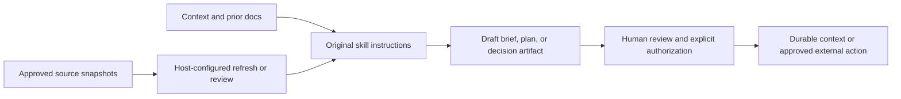

# Company OS

Company OS is a file-first skills workspace for running recurring company work with an existing agent host. The exported skills are original authored workflow instructions from the private Company OS workspace, retained byte-for-byte where safe. They turn company context, source snapshots, and prior documents into repeatable briefs, strategy work, research, product documents, roadmaps, and communications.

This repository is the workspace layer, not a hosted autonomous-company product. It contains no model runtime, connector credentials, scheduler, database, production integration, or background agent. A configured Codex or Claude Code host reads these files and performs only the tools and actions you explicitly make available.

## What is included

- **Operating context templates:** current context, goals, narratives, cadences, artifacts, tasks, and document folders.
- **Original skill instructions:** a curated selection covering status, strategy, shaping, PRDs, roadmaps, market research, and essays.
- **Host-facing orchestration:** original status and roadmap workflows demonstrate source-linked operating artifacts without exposing the private source registry that powered them.
- **Writing utilities:** the original document-writing and Google Docs formatting instructions.

The file inventory and SHA-256 hashes are in [EXPORT-MANIFEST.md](EXPORT-MANIFEST.md). Files retained unchanged are copied byte-for-byte. The workspace adapter and a small set of workflow instructions retain their original structure with documented privacy substitutions.

## What is deliberately absent

- Private company context, real tasks, documents, people, customer information, caches, source snapshots, and credentials.
- Host-specific source configuration, login state, and automation schedules.
- Skills containing personal operating history, relationship records, source-specific private access instructions, or extensive client/domain examples that could not be safely exported without a rewrite.
- Separate application prototypes. This repository is the skills workspace, not a product UI or agent runtime.

Some retained instructions refer to optional snapshots, meeting context, or companion skills from the original private workspace. They are intentionally absent here. Treat those references as extension points for your own private configuration, not as included functionality.

## Start with your own host and sources

1. Replace the `{{PLACEHOLDERS}}` in `CLAUDE.md`, `context/`, and `tasks-db.md` with your own company context.
2. Configure the tools and source access you want your host to use. Keep raw source snapshots and credentials out of version control.
3. Start Claude Code or Codex from the repository root.
4. Ask the host to read the workspace instructions and run the relevant skill.

For Claude Code:

```sh
claude
```

Then ask it to follow an included skill such as `.claude/skills/status/SKILL.md`.

For Codex, start from this directory and use a direct instruction such as:

```text
Read AGENTS.md and CLAUDE.md. Read the relevant context and existing docs.
Follow .claude/skills/status/SKILL.md to prepare a local status artifact.
Do not send messages or make external changes unless I explicitly authorize them.
```

## How the workspace works



The workflow is intentionally file-first: durable context and produced documents are inspectable and portable. Skill instructions guide the host; they do not enforce permissions, authenticate a user, prove source freshness, or authorize effects. Those controls belong to the configured host and the human operator.

## Evaluate the original workflows

The [evaluation package](evals/README.md) prepares isolated synthetic company workspaces and grades finite source-linked facts in artifacts produced under the original status, shaping, PRD and strategy instructions. It includes adversarial grader tests, retained failure controls, source locks and an honest [comparison report](evals/COMPARISON.md).

```sh
python3 -m unittest discover -s evals/tests -v
```

The evaluation CLI uses Python 3.9+ and the standard library. It makes no model or connector calls. Calibration measures the grader; model task success, cost, latency and business impact remain unmeasured. Missing original companion instructions remain disclosed. No original workflow was changed to improve a score.

## Provenance

This is a public-safe export of original Company OS templates and skills. The export preserves original files exactly when they contain no private operating data. It does not reproduce live source configuration, cache contents, company records, or application prototypes.
