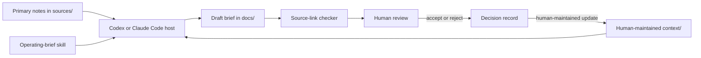

# Architecture

The host reads a bounded workspace and prepares a source-linked draft. The deterministic checker verifies local source references. A human remains responsible for acceptance, external action, and updating durable context.

The arrows are a working method, not a runtime service. There is no connector, scheduler, permission service, database, or autonomous execution loop in this repository.
